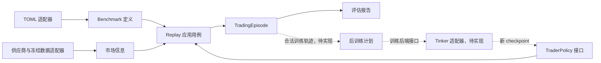

# DDD 领域建模与第一版实现

系统要回答三个不同问题：交易者在当时信息下能做什么；按固定规则执行后得到什么结果；利用合法训练反馈能否得到更好的模型。三个问题不能共用一个可以任意修改规则的 agent loop。

先采用模块化单体。领域层不依赖 SDK、供应商或网络；应用层编排用例；适配器负责 TOML、数据源、模型和持久化。暂不引入微服务、通用消息总线或完整 event sourcing。

## 限界上下文

| 上下文 | 负责的语言与概念 | 聚合/模型 | 边界 |
| --- | --- | --- | --- |
| Benchmark 定义 | 题目、环境规则、目标、数据分区 | 不可变 BenchmarkTask、ProfitGoal、ExecutionRules | 规则来自已验证配置，模型不能改规则 |
| 市场信息 | 公开时间、事件时间、历史版本、交易时段 | InformationRecord、MarketSnapshot、TradingSession | provider 字段经适配后进入领域；未来行情不交给 policy |
| 交易执行 | 仓位意图、现金、持股、成交、净值 | TradingEpisode 聚合，Account/TargetWeight 值对象 | 一次 session 结算原子更新同一账户和时钟 |
| Benchmark 评估 | 终局收益、回撤、是否达标 | EvaluationReport，evaluate 领域服务 | 只评分完成的 episode；不改交易奖励或策略 |
| 后训练 | 轨迹来源、训练方法、目标版本、checkpoint | PostTrainingPlan、TrajectoryReference | 仅 train 轨迹进入更新；Tinker 是后端适配器 |
| RSI 实验管理（待实现） | 父模型、实验预算、晋级、回滚 | ImprovementRound（设计预留，未落代码） | 比较合法验证结果；最终测试不回流训练 |

领域中不同上下文不共用一个万能“模型”：trader policy 是产生仓位的行为；训练后的 checkpoint 是后训练产物；benchmark task 是固定实验定义。



## 聚合与不变量

TradingEpisode 是核心聚合根，独占账户、决策时钟和不可变结算事件。账户不允许负现金、负持仓或小数股。TargetWeight 必须为 [0, 1] 的 Decimal。费用与价格采用 Decimal，避免将 float 混入金额计算。

一个命令把“已有收盘决策 + 下一 session 的开盘成交 + 该 session 的收盘估值”作为一次结算。未来 bar 由应用层持有，策略只获得 MarketSnapshot 和 Account。失败命令不写入事件、不推进时钟；完成后拒绝额外交易。SessionSettled 是不可变领域事件/账本记录，当前保存在内存，不声称已经实现可重放的持久化事件存储。

信息公开性按 available_at，而不是 report period/event_time 判断。MarketSnapshot 构造时再次拒绝未来或异标的记录。分部重列和更正保留多版本；领域当前保留全部已可见记录，尚未实现财报解析和默认“最新版本”查询。

PostTrainingPlan 要求轨迹具有配置/数据哈希、policy revision、分区和唯一 ID；验证与测试轨迹不能进入更新。此模型只能防止调用者提交显式标注的违规引用，不能证明文件内容、分区标签或远程后端没有造假；后续还需受控轨迹仓库和权限隔离。

## 接口与防腐层

- MarketHistory：按 symbol 与 decision_time 返回只含可见记录的快照。
- SessionCalendar：提供精确 horizon 的后续 session。真实适配器必须核对 XNAS 假日、夏令时和起点收盘；ExplicitSessions 只用于 fixture。
- TraderPolicy：snapshot + account → TargetWeight。LLM 输出解析和错误处理应在模型适配器完成，不允许领域执行自由文本。
- EpisodeRepository：持久化交易聚合。后续采用带版本的事务/乐观锁，保证同一个 episode 的命令串行执行。
- PostTrainingBackend：合法计划 → checkpoint reference。Tinker 的 tokens、logprobs、LoRA 与训练状态不进入交易聚合。

TOML compiler 复用现有 v0.1 校验器，编译为强类型定义，并对题目与环境原始字节生成联合 SHA-256。它没有升级数据就绪能力：完整执行还需要数据清单逐文件核验和合法日历。配置不可变部署与读写原子性由后续工件仓库负责。

## 已实现与缺口

已实现：TOML → 类型化题目；时点可见性；整数股目标仓位；次日开盘撮合；买卖滑点与手续费；资金不足向下缩量；拒单不顺延；收盘估值与陈旧标记；净收益、回撤、换手、成交次数、目标评分；内存 replay；后训练输入分区约束。

尚未实现：真实日历/数据与指标、财报查询、拆股与分红资格账本、基线对齐和 excess-return、轨迹持久化、模型推理/Tinker、训练闭环及 RSI 晋级。收到企业行动的 session 会在账户更新前明确报错，因此当前 replay 不能用于包含分红/拆股的完整历史 Benchmark。完整 v0.1 引擎仍未就绪，配置校验器的 engine_implemented=false 保持有效。

运行（Python 3.11+）：

```sh
python3 -m unittest discover -s tests
python3 -m scripts.demo_domain
```

demo 是人工构造的两日行情，用于演示领域流程；不是 INTC 历史回测，也不是策略效果证据。真实 Benchmark 的 ready 检查不会被 demo 绕过为可发布结果。

下一步优先完成 corporate-action ledger 与冻结数据/日历适配器，将真实 Benchmark 接入确定性账本，再实现 TraderPolicy 的 LLM 适配和 Tinker Env。训练 reward 在后训练上下文单独版本化，不覆盖 Benchmark 的达标规则。
