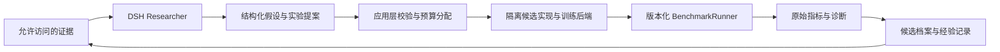

# 基于 DeepSeek Harness 的 Researcher：论文与复用调查

检索与源码核查日期：2026-10-15。覆盖截至当日可检索的相关工作，包含 2026 年 9—10 月预印本；不是穷尽文献的系统综述。阅读范围和版本见 [papers.json](papers.json)，均未在本项目复现论文效果。

建议采用 **DSH Python SDK 作为研究执行器，应用层管理实验状态与预算，借鉴 RD-Agent 的假设闭环，按需接入 GEPA 的文本候选搜索，并维护可追溯经验记录**。这是本项目的工程判断。当前先做小规模、串行实验；扩大数据覆盖后再比较树搜索和多 Agent 的收益。

## 已发表方法与近期进展

| 工作 / 本次阅读版本 | 关键机制 | 本项目的复用判断 |
| --- | --- | --- |
| [RD-Agent-Quant，2025-05](https://arxiv.org/abs/2505.15155v1) | Research / Development / Feedback 闭环，因子与模型联合探索 | 最贴近量化研究；借鉴假设、任务、实现、实验反馈的分离。其 Qlib 因子预测任务与我们的 LLM trader 后训练目标不同。 |
| [AIDE，2025-02](https://arxiv.org/abs/2502.13138v1) | 在代码候选树上执行 draft / debug / improve | 候选保存父版本、代码和实验报告；失败后能从其他父节点继续，适合第二阶段搜索。 |
| [AI Scientist-v2，2025-04](https://arxiv.org/abs/2504.08066v1) | 分阶段实验管理与树搜索 | 借鉴实验阶段推进和消融；自动写整篇论文不是当前核心需求。 |
| [GEPA，v2，2026-02 修订](https://arxiv.org/abs/2507.19457v2) | 读取轨迹做反思式文本变异，保留互补候选 | 优先试验 trader 提示词与输入构造方案。属于上下文/程序优化，不产生新的模型权重。 |
| [ACE，v1，2025-10](https://arxiv.org/abs/2510.04618v1) | Generator / Reflector / Curator，增量维护 playbook | 将经验保存为有证据的条目，避免每轮整体重写“研究总结”。原论文后续有修订，本次机制阅读锁定 v1。 |
| [MCE，v1，2026-01](https://arxiv.org/abs/2601.21557v1) | 上层改进上下文工程技能，下层用技能改进上下文 | 后续研究“Researcher 如何改善研究方法”的参考；暂不同时开放两层搜索。 |
| [AutoScientists，2026-05](https://arxiv.org/abs/2605.28655v1) | 共享实验状态、实验前批评、负结果登记、噪声感知晋级 | 先复用队列、失败记忆和复测思路；论文的非金融结果不构成本项目多 Agent 更优的证据。 |
| [AgentX-Model，2026-09-24](https://arxiv.org/abs/2609.30001v1) | 长周期 Research Agent 与执行调查的 Model Agent 分工，保留逐轮实现及证据 | 可借鉴“提案—独立审查—调查—保留结果”的设计。工业推荐系统报告，本轮未找到可直接复用的官方完整代码。 |
| [Deep-Research Prompt Optimization，2026-10-08](https://arxiv.org/abs/2610.12601v1) | 主题隔离、多种子、验证器消融，检验提示词优化的迁移 | 其引用任务实验中，分解反馈比单个总分更有助于迁移；我们应记录各类失败原因，再在不同标的/时间验证，不能直接外推其增益。 |
| [DGM，v1，2025-05](https://arxiv.org/abs/2505.22954v1)；[Hyperagents，2026-03](https://arxiv.org/abs/2603.19461v1) | 分别探索 Agent 代码档案演化、连改进机制也可修改的元级演化 | 说明“系统自改进”与“权重训练”是不同层次；当前先固定评测与执行器，不开放整个系统的递归改写。 |

这里的范式变化可概括为：把研究当成有状态的实验搜索，而不只生成一份研究报告；保留证据、候选谱系和失败原因，再用独立评估决定是否采纳。这是基于上表工作的综合判断，并非某篇论文的统一结论。

## 已核对的可复用代码

仅克隆并阅读代码，没有安装依赖、启动第三方 Agent 或调用付费模型。五个仓库的完整 commit 和阅读位置记录在 [research-agent-sources.json](research-agent-sources.json)。

| 组件 | 源码入口 | 复用方式与边界 |
| --- | --- | --- |
| [DeepSeek Harness](https://github.com/deepseek-ai/deepseek-harness) | `python/sdk/`、`packages/sdk/` | 官方 Python SDK 启动 stdio JSON-RPC 子进程，提供会话运行、事件和恢复；作为应用适配器。MIT。 |
| [GEPA](https://github.com/gepa-ai/gepa) | `src/gepa/core/adapter.py` | `evaluate` 返回逐题评分和可选轨迹；`make_reflective_dataset` 构造反思材料；可自定义候选提议。MIT。 |
| [RD-Agent](https://github.com/microsoft/RD-Agent) | `rdagent/app/qlib_rd_loop/quant.py` | 已核对 hypothesis、coder、runner、feedback 的组装及工作流恢复。借鉴结构，避免将 Qlib/Docker 工作流整个引入当前系统。MIT。 |
| [AutoScientists](https://github.com/mims-harvard/AutoScientists) | `runbook.md`、任务 profile | 参考共享队列与实验协议。实现使用 Claude Code / ClawInstitute，不能直接当作 DSH 插件；本轮未找到明确许可证文件，暂不复制其实现代码。 |
| [autoresearch](https://github.com/karpathy/autoresearch) | `program.md`、`prepare.py`、`train.py` | 最简固定预算实验闭环：评测固定、候选可改、结果保留/丢弃。README 声明 MIT，未找到独立 LICENSE 文件；这里仅借鉴方法。不是一篇同行评审论文。 |

GEPA 的 Pareto 搜索保留不同样本上的互补优势，不等于自动解决收益与回撤的多目标优化。需要单独版本化搜索评分映射，同时保留原始 Benchmark 指标和约束；不得让搜索器改 Benchmark 的成功定义。也不应同时让 GEPA 与另一个自治循环各自分配同一实验预算。

本轮 GEPA 源码还包含 `optimize_anything` 及独立 Engine / EvalServer 接口，适用范围已超过单个提示词。可考虑把文本化的实验配方纳入搜索，但仍应经本项目类型校验再执行；无需为了使用 GEPA 把领域模型迁移到 DSPy。[固定版本实现](https://github.com/gepa-ai/gepa/blob/f1cfdee2856e9dc4b5b4dc5cc2e391d0aa20d819/src/gepa/oa/engine.py)

## DSH 的实际接入边界

本轮源码核查为 `571902028a75c64c1d767f4ae5fd099485f0ddf0`，提交日期 2026-10-14；已安装桌面版仍是先前记录的 0.2.0-rc.2，没有升级。[固定版本 SDK 说明](https://github.com/deepseek-ai/deepseek-harness/blob/571902028a75c64c1d767f4ae5fd099485f0ddf0/python/sdk/README.md)

SDK 的 `DeepSeekHarness.run()`、`RunResult.events/notifications` 可以支持一次研究任务及事件采集；新源码增加 `resume_session()`。后续安装时须锁定匹配的 SDK/runtime 发布版本，并做协议测试，不能假定桌面版已包含新接口。源码 pyproject 的开发占位版本不是可直接安装的发布版本。

`dsh_home` 必须显式设置，SDK 不会自动读取桌面端 `~/.dsh`；凭据在启动边界注入，不进入提案、配置工件或事件。模型维持项目既定的 `deepseek-v4-pro`，本轮没有再次验证账户余额或生成能力。

隔离目录和 `cwd` 不等于沙箱。已核查的 `sdk-minimal` 默认使用 `danger-full-access`，并缺省挂载 session-log 上传插件。接入研究任务时，应使用经过检查的专用 profile、显式设置日志传输策略，并让受限工具/隔离执行器承载实验；无需给研究进程完整轨迹数据库或评测数据目录。这里描述的是后续接入要求，当前未部署这些边界。[profile 源码](https://github.com/deepseek-ai/deepseek-harness/blob/571902028a75c64c1d767f4ae5fd099485f0ddf0/packages/bundle/sdk-minimal/cordis.patch.yml)

SDK 的单次输出 `max_tokens` 不是整轮研究预算。应用层还需累计模型调用、模型 token、交易 rollout、训练作业、重试和时间，并设置会话超时及取消。DSH 日志只作为原始工件，事件经过脱敏和规范化后进入现有 Researcher 轨迹契约。

## 与现有 DDD 设计衔接的建议

以下是设计提案，尚未实现。[声明式设计记录](../../configs/researcher/research-loop-design.toml) 同样不可执行。

建议领域对象为 `ResearchCampaign`、`Hypothesis`、`ExperimentSpec`、`ExperimentAttempt`、`CandidateRevision`、`Finding` 和 `PromotionDecision`。候选既可以是 prompt/输入构造代码，也可以是数据构建配方、训练配置或 checkpoint，必须声明类型与父版本，不能混成一个“更好模型”标签。

Researcher 通过受控端口读取证据索引、获取允许的摘要、提交提案/候选、查询实验结果。应用持有执行权限，经 `BenchmarkRunner`、`PostTrainingBackend` 和存储端口完成实际工作。DSH、SQLite、Serverless DB、外部 Benchmark 的类型不进入研究领域。

提案至少包括：证据 IDs、可证伪假设、父候选、拟改组件、对照与消融、数据/任务摘要、预期改善维度、失败判据、预算和复测方案。先明确要回答什么，再启动实验。经验条目记录适用条件、支持/反例实验及修订历史；尚未验证的解释保持 hypothesis 状态，不升级成“事实”。

首版采用单个 Researcher 会话串行推进；必要时用独立上下文做提案审查。候选谱系先支持分叉和归档，搜索策略先简单；不需要一开始部署多 Agent 讨论系统。晋级由应用根据预注册的跨题表现、风险约束和预算决定，Researcher 的自评不能直接晋级。

## 首个研究问题与验证顺序

现有 INTC pilot 展示了“旧财报下高仓位暴露、公开新报告后降仓”的轨迹，但单次结果不能证明原因。可提出一般性假设：**把已公开的事件时点和报告新鲜度显式表示，是否改善事件前后的仓位决策？** 不写入具体股票/日期/未来方向，也不让输入构造器接触未来 session bars。

先补齐 train 标的/窗口与时点证据，验证所有候选都只能读取同一个信息快照。在这些 train 任务上比较原输入、增加公开事件/新鲜度字段、仅增加风险提示，以及二者组合；这样能区分信息表示与提示词的作用。所有方案固定模型、费用、撮合、目标和数据版本。

INTC 当前属于 validation，允许的诊断摘要可以启发问题和选择候选，但其完整轨迹不进入 GEPA 的反思训练集、trader playbook 或后训练数据。当前接口若无法提供可靠事件时点，应报告数据缺口，而不是从事后大跌反推“已知风险”。

之后再接 Tinker：只用 train 数据构造配方，分别评估权重不变的上下文优化、SFT/LoRA 权重更新及二者组合。Researcher 经验更新、trader 提示词更新与 trader 权重更新应分别记账，不能把前两者的进步称为已经获得更强的后训练 checkpoint。

正式多题评估按标的、时间与重叠事件分组，防止同一行情事件进入训练和最终测试；重复种子只能测采样波动，不能把相关的 20 道题变成 20 个独立市场样本。保留简单人工修改基线、固定总实验预算与独立最终测试，记录所有尝试及对验证反馈的访问。Pilot 数据和一个 validation 题目足以验证闭环接口，尚不足以证明 RSI 带来泛化提升。
